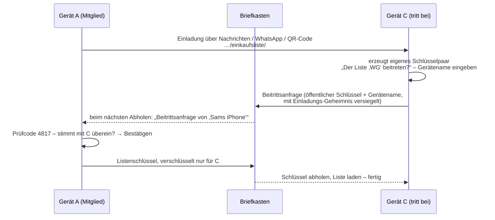

# FeedYourself – App-Konzept (Entwurf v0.7)

Web-App (PWA) fürs iPhone, nach der Installation vollständig offline. (Ursprünglich als native iOS-App geplant, siehe Kapitel 7.) Eine grafische, interaktive Einkaufsliste mit zwei Modi: **Planung** und **Einkauf**.

Mockup (klickbar): https://claude.ai/artifact/TakTedz3vtBNwH9KyWkPJH

---

## 1. Ziele & Grundsätze

- **Schnell erfassen:** Ein Produkt soll in < 3 Sekunden auf der Liste sein (tippen → Vorschlag → bestätigen).
- **Grafisch statt Text:** Jedes Produkt hat ein Foto. Im Einkaufsmodus erkennt man Produkte auf einen Blick.
- **Laden-Logik:** Kategorien folgen dem Laufweg im Laden (frei sortierbar).
- **Lernend:** Gekaufte Produkte werden gemerkt und lassen sich mit einem Tipp wieder hinzufügen.
- **Offline first:** Keine Netzwerkverbindung, kein Konto. Datenmodell aber so gebaut, dass später Teilen via iCloud möglich ist.

---

## 2. Die zwei Modi

Umschalten über einen großen Segment-Schalter oben oder eine Tab-Leiste: **Planen | Einkaufen**.

### 2.1 Planungsmodus

```
┌─────────────────────────────────┐
│  🔍 Was brauchst du?            │  ← Suchfeld, immer oben, Tastatur sofort aktiv
├─────────────────────────────────┤
│  Vorschläge beim Tippen "oli":  │
│  [📷 Olivenöl]  [📷 Oliven]     │  ← Treffer aus Katalog + Verlauf
│  + „oli" als neues Produkt      │
├─────────────────────────────────┤
│  OBST & GEMÜSE                  │
│  📷 Äpfel        2x   „Elstar"  │
│  📷 Tomaten      1x             │
│  BACKWAREN                      │
│  📷 Brot         1x   „Dinkel"  │
│  ÖLE & GEWÜRZE                  │
│  📷 Olivenöl     2x   „Bertolli"│
├─────────────────────────────────┤
│  ⟲ Zuletzt gekauft  (12)        │  ← aufklappbar, 1 Tipp = wieder hinzufügen
└─────────────────────────────────┘
```

**Suche & Hinzufügen**
- Suche im Produktkatalog (vorinstalliert, ca. 250–400 gängige Lebensmittel) und in eigenen Produkten.
- Tolerant: Groß-/Kleinschreibung, Umlaute („Ol" findet „Öl"), Teilwörter („nudel" → „Spaghetti", „Penne" über Synonyme), einfache Tippfehler.
- Sortierung der Treffer: zuletzt/häufig gekauft zuerst, dann alphabetisch.
- **Enter / Tipp auf Treffer** → Produkt landet in seiner Kategorie auf der Liste (Menge 1).
- Erneutes Hinzufügen eines bereits gelisteten Produkts → Menge +1 statt Duplikat.
- Kein Treffer → „‚Kokosmilch' als neues Produkt anlegen": Kategorie wählen, optional Foto mit Kamera aufnehmen oder aus Fotos wählen.

**Listeneintrag bearbeiten** (Tipp auf Eintrag öffnet ein kleines Sheet)
- **Menge:** Stepper (− 2x +). Optional später: Einheit (500 g, 1 l).
- **Anmerkung:** Freitext, z. B. Sorte, Marke („Elstar", „Barilla Nr. 5").
- Kategorie ändern, Eintrag löschen (auch per Wischen nach links).

**Zuletzt gekauft / Häufig gekauft**
- Bereich unter der Liste (oder eigener Reiter) mit allen früher gekauften Produkten als Foto-Kacheln.
- 1 Tipp = auf die Liste, mit **zuletzt verwendeter Menge und Anmerkung** vorausgefüllt.
- Sortierbar nach „zuletzt" oder „am häufigsten".

### 2.2 Einkaufsmodus

```
┌─────────────────────────────────┐
│  Einkauf  ▓▓▓▓▓▓░░░░  6 / 10    │  ← Fortschritt
├─────────────────────────────────┤
│  OBST & GEMÜSE                  │
│  ┌──────────┐ ┌──────────┐      │
│  │  [FOTO]  │ │  [FOTO]  │      │  ← große Foto-Kacheln
│  │  Äpfel   │ │ Tomaten  │      │
│  │ 2x Elstar│ │    1x    │      │
│  └──────────┘ └──────────┘      │
│  BACKWAREN                      │
│  ┌──────────┐                   │
│  │  [FOTO]  │                   │
│  │   Brot   │                   │
│  └──────────┘                   │
├─────────────────────────────────┤
│  🛒 Im Wagen (4)  ˅             │  ← eingeklappt, zum Rückgängig-Machen
│        [ Einkauf abschließen ]  │
└─────────────────────────────────┘
```

- Zeigt **nur offene (fehlende) Produkte**, gruppiert nach Kategorie in **Laden-Reihenfolge**.
- **Drei Ansichten, umschaltbar** (Schalter oben rechts, Auswahl wird gemerkt):
  - **Kacheln** (Standard): 2 große Foto-Kacheln pro Zeile.
  - **Liste**: Foto links, mehr Produkte gleichzeitig sichtbar.
  - **Fokus**: immer nur **ein** Produkt als große Karte, in Laden-Reihenfolge, wie ein Kartenstapel. Ideal mit einer Hand oder wenn man nicht auf die Liste schauen will. Darunter steht „Noch 6 offen · danach: Tomaten".
  - Aufwand gering: Alle Ansichten nutzen dieselben Daten und dieselbe Gesten-Logik, nur die Anordnung (`LazyVGrid`, `List`, Kartenstapel) unterscheidet sich.
- Name, Menge und Anmerkung sind gut lesbar, auch mit einer Hand im Laden.
- **Gesten:**

  | Geste | Kacheln & Liste | Fokus |
  |-------|-----------------|-------|
  | Tippen | in den Wagen | **überspringen** – Produkt ans Ende der Reihe, beliebig oft (nur für diesen Einkauf) |
  | → nach rechts wischen | in den Wagen | in den Wagen |
  | ← nach links wischen | zurückstellen / nicht vorhanden | zurückstellen / nicht vorhanden |

  - Nur waagerechte Gesten – senkrecht wird überall gescrollt, auch in der Fokus-Ansicht. (Hochwischen gab es anfangs in der Fokus-Ansicht; entfernt, weil es beim Scrollen störte.)
  - Beim Ziehen färbt sich die Karte (grün bzw. gelb = Wagen, blau = zurückstellen), ab ~80 pt Weg wird ausgelöst, dazu kommt haptisches Feedback.
  - Zusätzlich gibt es auf jeder Karte einen kleinen ←-Knopf und in der Fokus-Ansicht zwei große Knöpfe (für VoiceOver und Bedienung ohne Wischen).
  - In SwiftUI: `DragGesture` mit Richtungsprüfung (waagerecht nur, wenn |dx| > |dy|), in der Liste alternativ die nativen `swipeActions`.
- **Rückgängig:** Toast „Äpfel im Wagen · Rückgängig" für einige Sekunden; außerdem einklappbare Bereiche „Zurückgestellt" und „Im Wagen", in denen sich jedes Produkt zurückholen lässt.
- Leere Kategorien werden ausgeblendet.
- Das Display bleibt während des Einkaufs an (optional, Einstellung).
- **Einkauf abschließen** nur **per Knopf** (immer sichtbar unten):
  - Produkte im Wagen kommen in „Zuletzt gekauft" (Verlauf).
  - Zurückgestellte und noch offene Produkte bleiben für den nächsten Einkauf auf der Liste.
  - Danach eine Zusammenfassung: „7 Produkte gekauft · 1 bleibt auf der Liste".

### 2.3 Lebenszyklus eines Eintrags

```
 Katalog/Verlauf ──hinzufügen──▶ OFFEN ──tippen / → wischen──▶ IM WAGEN ──abschließen──▶ GEKAUFT (Verlauf)
                                 │  ▲                            │                            │
                    ← wischen    │  └──────── rückgängig ────────┘                            │
                                 ▼                                                            │
                          ZURÜCKGESTELLT ──abschließen──▶ bleibt OFFEN für nächsten Einkauf   │
                                                                                              │
                                 ▲─────────────────── 1 Tipp „wieder hinzufügen" ─────────────┘
```

---

## 3. Kategorien

Standard-Kategorien (umbenennbar, erweiterbar, per Drag & Drop in Laden-Reihenfolge sortierbar):

| # | Kategorie | Beispiele |
|---|-----------|-----------|
| 1 | Obst | Äpfel, Bananen, Zitronen |
| 2 | Gemüse | Tomaten, Paprika, Zwiebeln |
| 3 | Backwaren | Brot, Brötchen, Toast |
| 4 | Fleisch & Wurst | Hähnchen, Hack, Salami |
| 5 | Fisch | Lachs, Thunfisch |
| 6 | Milchprodukte & Eier | Milch, Joghurt, Eier, Butter |
| 7 | Käse | Gouda, Mozzarella, Parmesan |
| 8 | Tiefkühl | Pizza, Erbsen, Eis |
| 9 | Nudeln, Reis & Getreide | Spaghetti, Reis, Haferflocken |
| 10 | Konserven & Fertiges | Tomaten passiert, Bohnen |
| 11 | Öle, Essig & Gewürze | Olivenöl, Salz, Pfeffer |
| 12 | Backen & Süßes | Mehl, Zucker, Schokolade |
| 13 | Snacks | Chips, Nüsse |
| 14 | Getränke | Wasser, Saft, Kaffee, Tee |
| 15 | Drogerie & Haushalt | Spülmittel, Toilettenpapier |
| 16 | Sonstiges | Fallback für alles andere |

### 3.1 Produktkatalog & Suchbegriffe

**Stand heute** (`Catalog/catalog.json`, Entwurf zur Durchsicht): **194 Produkte in 16 Kategorien mit 324 Synonymen**, davon 87 aus deiner eigenen Einkaufsliste (in der Übersicht mit ● markiert, im JSON als `"origin": "nutzer"`). Lesbare Übersicht: [Catalog/KATALOG.md](Catalog/KATALOG.md), erzeugt und geprüft mit `python3 tools/catalog/katalog.py`. Jedes Produkt hat:

| Feld | Zweck | Beispiel |
|------|-------|----------|
| `name` | Anzeige und Suche in der App | Karotten |
| `synonyms` | weitere Suchwörter in der App | Möhren, Möhre |
| `query_en` | englischer Suchbegriff, nur für das optionale Foto-Werkzeug | carrots |

**Herkunft:** Die Liste habe ich von Hand zusammengestellt, aus gängigen Produkten eines deutschen Supermarkts. Sie stammt aus keiner Datenbank, deshalb gibt es keine Lizenzfragen.

**Ziel für v1.0:** ca. **150 Produkte in allen 16 Kategorien**, mit 2–4 Synonymen pro Produkt (regionale Begriffe wie Semmel/Brötchen, Oberbegriffe wie Nudeln → Spaghetti/Penne, Singular/Plural). Das ergibt rund 400–500 Suchwörter.

**Wie wir dorthin kommen:**
1. Ich erstelle einen Entwurf (Produkte, Kategorie, Synonyme), du streichst und ergänzt nach deinen Einkaufsgewohnheiten.
2. Optional zum Abgleich: **Wikidata** (Lizenz CC0, frei nutzbar) hat zu vielen Lebensmitteln deutsche Bezeichnungen und Alternativnamen. Open Food Facts eignet sich weniger: Es enthält vor allem Markenprodukte, und seine Datenbanklizenz (ODbL) verlangt Namensnennung und Weitergabe unter gleichen Bedingungen.

**In der App** kommen außerdem automatisch dazu:
- eigene Produkte, die man über die Suche anlegt,
- Begriffe, die man häufig eintippt: Die Suche lernt, was man nach Eingabe von „nud“ auswählt, und zeigt es künftig zuerst.

Die Suche bleibt tolerant (Umlaute, Teilwörter, kleine Tippfehler), damit auch Wörter gefunden werden, die nicht im Katalog stehen.

### 3.2 Einstellungen

Erreichbar über das Regler-Symbol oben rechts (in beiden Modi), öffnet sich als eigener Bildschirm.

**Kategorien festlegen**
- Liste aller Kategorien in Laden-Reihenfolge, mit Nummer, Symbol und Anzahl der Produkte.
- **Umbenennen:** direkt auf den Namen tippen und tippen. Wird das Feld leer gelassen, heißt sie „Neue Kategorie".
- **Reihenfolge ändern:** per Drag & Drop am Griff; mit Tastatur/Screenreader über die Pfeiltasten auf dem Griff.
- **Hinzufügen:** „+ Kategorie hinzufügen" legt eine neue Kategorie vor „Sonstiges" an.
- **Löschen:** Die Produkte der Kategorie wandern nach „Sonstiges", mit Rückgängig. „Sonstiges" selbst lässt sich nicht löschen (Auffangkategorie). Gelöschte Katalog-Kategorien legt ein späteres Katalog-Update nicht wieder an.
- Später möglich: Symbol und Farbfläche einer Kategorie wählen, Kategorie eines Produkts im Bearbeiten-Sheet ändern.

**Einkauf**
- Display beim Einkaufen anlassen (Ein/Aus).

Weitere Punkte kommen dazu, sobald sie festgelegt sind (z. B. Standardansicht im Einkauf, Bildnachweise).


### 3.3 Maßeinheiten ✅

| Einheit | Anzeige | Schritt (Plus/Minus) | Startwert |
|---|---|---|---|
| Stück | 4× | 1 | 1 |
| Packung | 2 Pck. | 1 | 1 |
| Gramm | 500 g | 100 | 500 |
| Kilogramm | 1,5 kg | 0,5 | 1 |
| Milliliter | 500 ml | 100 | 500 |
| Liter | 1,5 l | 0,5 | 1 |

- **Je Produkt** eine Standard-Einheit (Einstellungen › „Einheiten je Produkt“, mit Suche), z. B. Äpfel in Kilogramm. Gilt ab dem nächsten Hinzufügen; ohne Festlegung: Stück.
- **Je Eintrag** änderbar im Bearbeiten-Fenster (Auswahl „Einheit“); die Menge springt dann auf den Startwert der neuen Einheit.
- Minus an der kleinsten Menge entfernt den Eintrag (in der Liste, mit Rückgängig); im Bearbeiten-Fenster bleibt er stehen.
- „Zuletzt gekauft“, geteilte Listen und die Sicherung behalten Menge **und** Einheit. Wurde die Standard-Einheit seit dem letzten Kauf geändert, startet das Produkt mit dem Startwert der neuen Einheit (nicht „6 kg“ statt „6 Stück“).
- Geteilte Liste mit anderer Einheit als die eigene: die eigene Menge bleibt.
- Optional kann `catalog.json` je Produkt eine Einheit vorgeben (`"unit": "kg"`).

---

## 4. Bilder (Fotos)

Entscheidung: **realistische Fotos**, offline in der App mitgeliefert.

### 4.1 Lizenzfreie Fotos für den Basis-Katalog

| Quelle | Lizenz | Hinweis |
|--------|--------|---------|
| **Pexels** | Pexels-Lizenz: kostenlos, auch kommerziell, ohne Namensnennung | Große Auswahl an Lebensmittelfotos, empfohlen |
| **Unsplash** | Unsplash-Lizenz: kostenlos, auch kommerziell | Verboten ist nur, eine konkurrierende Bilddatenbank aufzubauen; Fotos in einer App mitzuliefern ist erlaubt |
| **Pixabay** | Pixabay-Lizenz: ähnlich wie Pexels | Teilweise schon freigestellte Bilder |
| Wikimedia Commons | gemischt (CC0, CC-BY, CC-BY-SA) | Nur CC0 ohne Aufwand; bei CC-BY Namensnennung in der App nötig |
| ~~Open Food Facts~~ | CC-BY-SA | Enthält Markenverpackungen, eher ungeeignet |

- **Einheitlicher Look:** Produkte werden freigestellt (Hintergrund entfernt) und auf einer **zarten Kategorie-Farbfläche** gezeigt (siehe Mockup). So passen Fotos aus verschiedenen Quellen zusammen und funktionieren auch im Dark Mode. Freistellen geht z. B. mit der macOS-Vorschau oder Fotos-App („Motiv kopieren“) oder per Stapelverarbeitung mit Apples Vision-Framework.
- **Format:** Quadratisch, 600×600 px (@3x für die Kacheln), PNG mit Transparenz und beim Build als HEIC komprimiert, ca. 30–50 KB pro Bild → bei 300 Produkten ca. 12 MB.
- **Nachweis:** Eine Datei `image-credits.json` (Produkt → Quelle, URL, Lizenz) wird mitgepflegt. Sie wird nicht zwingend angezeigt, sichert aber die Herkunft ab.
- **Fallback:** Ohne Foto erscheint die Kategorie-Farbfläche mit einem Kategorie-Symbol.

### 4.2 Optional: Fotos automatisch im Stapel abrufen (Pixabay/Pexels)

> **Optional, vorerst zurückgestellt.** Das Werkzeug ist fertig, wird aber erst einmal nicht genutzt. Vorrang hat der Import eigener Bilder aus einem Projektordner (4.4). Das Werkzeug kann später zum Füllen von Lücken dienen.

Umgesetzt in `tools/photos/` (Anleitung: [tools/photos/README.md](tools/photos/README.md)). Das Skript läuft auf dem Mac, die App bleibt offline.

1. **Eingabe:** `Catalog/catalog.json` mit ID, Name, Kategorie, Synonymen und englischem Suchbegriff (Start: 38 Produkte aus dem Mockup).
2. **`fetch`:** eine Suche pro Produkt bei **Pixabay** (Standard) und/oder **Pexels**, 6 Kandidaten, 24 h Cache. „isolated“ wird angehängt, damit Fotos auf weißem Grund kommen. Es gibt nur Metadaten und Vorschau-Links, noch keine Downloads.
3. **`review`:** lokale Auswahlseite im Browser. Pro Produkt ein Foto anklicken oder „Keins passt“ wählen und einen neuen Suchbegriff eintragen. Die Auswahl wird automatisch gespeichert.
4. **`download`:** lädt nur die ausgewählten Fotos in voller Größe.
5. **`process`:** freistellen, mittig auf 600×600 setzen, transparentes PNG nach `Catalog/Images/`, Bildnachweise nach `Catalog/image-credits.json`.

**API-Bedingungen (geprüft am 14.10.2026):**
- **Pixabay:** Bilder selbst speichern ist erwünscht, dauerhaftes Hotlinking nicht. 24 h Caching ist Pflicht, max. 100 Anfragen pro Minute, die Quelle ist bei Anzeige der Ergebnisse zu nennen. **Automatisierte Massenabfragen und systematische Massen-Downloads sind verboten.** Das Werkzeug ist deshalb zurückhaltend gebaut: eine Suche pro Produkt, gedrosselt, Vorschauen werden nur angezeigt, geladen wird nur das ausgewählte Foto, und mehr als 150 Produkte auf einmal gehen nur mit ausdrücklicher Bestätigung. Für den vollen Katalog in Etappen arbeiten oder vorher bei Pixabay nachfragen.
- **Pexels:** 200 Anfragen pro Stunde. Ein sichtbarer Link zu Pexels und die Nennung der Fotograf:innen sind erwünscht → die App bekommt eine Seite „Bildnachweise“ in den Einstellungen. Das Speichern regelt die API-Doku nicht ausdrücklich.
- **Unsplash-API:** ungeeignet, weil Bilder von Unsplash-Servern geladen werden müssen.

**Freistellen auf Intel-Macs:** Apples Motiverkennung (`VNGenerateForegroundInstanceMaskRequest`) läuft nur auf Apple-Silicon-Macs. Auf Intel entfernt das Werkzeug stattdessen hellen, einfarbigen Hintergrund vom Bildrand her. Das klappt gut bei Fotos auf Weiß; bei anderen Fotos wird nur quadratisch zugeschnitten, und `process` listet diese Produkte auf.

### 4.3 Eigenes Foto pro Produkt (in der App) ✅

- Im Bearbeiten-Fenster eines Eintrags: **„Foto ändern“**. Das iPhone bietet dann **Foto aufnehmen**, **Fotomediathek** oder **Dateien** an.
- Die App bereitet das Foto **auf dem Gerät** auf, nichts wird hochgeladen:
  - auf 480 × 480 px bringen,
  - einen **hellen, einfarbigen Hintergrund entfernen** und das Motiv mittig mit Rand setzen,
  - klappt das nicht (dunkler oder unruhiger Hintergrund), wird das Foto quadratisch zugeschnitten, mit dem Hinweis, vor hellem Hintergrund zu fotografieren,
  - speichern als WebP; wo der Browser das nicht kann, als PNG (mit Transparenz) bzw. JPEG.
- Das eigene Foto hat **Vorrang vor dem Katalogfoto** und erscheint überall: Liste, Kacheln, Fokus-Ansicht, „Zuletzt gekauft“, Vorschläge.
- **„Standardbild“** entfernt das eigene Foto wieder; beides lässt sich rückgängig machen.
- Eigene Fotos sind Teil der **Sicherung**, aber nicht der geteilten Liste (der Link soll kurz bleiben).
- Speicherort: IndexedDB, eigener Speicher `photos` (Produkt-ID → Bild).

### 4.4 Ordner-Import für den Basis-Katalog ✅

**Ablauf** (Anleitung auch in `Catalog/Inbox/LIESMICH.md`):
1. Fotos in `Catalog/Inbox/` legen. **Der Dateiname bestimmt das Produkt**: Name, ID oder ein eindeutiges Synonym, Groß-/Kleinschreibung und Umlaute egal (`Äpfel.png`, `olivenoel.jpg`, `Möhren.png` → Karotten).
2. `python3 tools/photos/photos.py import`
   - ordnet zu und meldet, was **nicht eindeutig** ist (z. B. `Nudeln.png` passt zu vier Produkten) oder **zu keinem Produkt** passt,
   - stellt frei, in dieser Reihenfolge: schon freigestelltes PNG nur zuschneiden → Apple Vision (nur Apple-Silicon-Macs) → hellen Hintergrund entfernen → sonst quadratisch zuschneiden,
   - schreibt `Catalog/Images/<id>.png` (480 × 480) und trägt „eigenes Foto“ in `Catalog/image-credits.json` ein,
   - verschiebt erledigte Dateien nach `Catalog/Inbox/erledigt/`.
3. `python3 tools/web/build.py` kopiert die Bilder nach `web/images/`, schreibt die Liste `web/data/images.json` und nimmt alles in den Offline-Speicher auf.

Originalfotos in der Inbox werden nicht ins Repository übernommen, die fertigen Bilder in `Catalog/Images/` schon.

**Freistellen ohne Apple-Silicon-Mac (Tipp):** Auf dem **iPhone** in der Fotos-App das Motiv lange gedrückt halten → „Kopieren“ bzw. „Teilen“ → als PNG sichern und per AirDrop in `Catalog/Inbox/` legen. Das iPhone stellt hervorragend frei, das Werkzeug übernimmt die Transparenz dann direkt. Alternativ die Produkte auf weißem Papier fotografieren; das klappt mit dem Hintergrund-Verfahren auch auf dem Intel-Mac.

**Aufwand:** ca. 150 Fotos für den Start. Für einen einheitlichen Look: Tageslicht, von schräg oben, Produkt füllt das Bild, ruhiger heller Untergrund.

---

## 5. Gestaltung & Farbwelt

**Designrichtung A „Galerie“ (entschieden am 15.10.2026): ruhig, hochwertig, clean. Ein grüner Akzent in beiden Modi – Tannengrün im Hellen, Salbeigrün im Dunkeln. Kein Gelb mehr.**

- **Neutraler Grund, Karten ohne Rahmen:** Weiße Karten mit weichem Schatten auf leicht grauem Weiß; im Dunkeln fast schwarzer Grund mit dunkelgrauen Karten. Kopf und Abschlussleiste sind Milchglas.
- **Eine ruhige Bildfläche für alle Produkte** (`Fläche Bild`). Die **Kategoriefarbe** erscheint nur noch als feiner Rahmen um Produktbild bzw. Symbol – dezent, aber beim Einkaufen zur Orientierung lesbar.
- **Fotos:** Freigestellte Bilder (PNG) stehen mit Rand auf der Bildfläche; Fotos mit Hintergrund (JPEG) füllen die Fläche randlos. Damit sie zur App passen, werden sie leicht entsättigt (Sättigung 88 %, Kontrast 94 %, im Dunkeln etwas abgedunkelt) und bekommen oben links einen feinen Glanz. In Kacheln und Fokus läuft das Foto unten weich in die Karte aus; Name und Menge stehen auf diesem Übergang.
- **Akzent sparsam:** Hauptknopf, Fortschritt, Mengen, „In den Wagen“. Struktur und Steuerelemente bleiben grau.
- **Typografie:** SF Pro für alles; große Überschrift „Einkaufsliste“ in SF Pro Display (32 pt, fett), Abschnittstitel in normaler Schreibweise statt Großbuchstaben. Wortmarke „Feed“ in Textfarbe, „Yourself“ in Sekundärgrau.
- **„Zurückstellen“** ist ein gedämpftes Schieferblau, **„Entfernen“** neutral grau mit Rückgängig.
- **Dichte:** großzügig wie im Mockup (Zeilen 64 pt, Kacheln zweispaltig).

| Rolle | Hell | Dunkel |
|-------|------|--------|
| Akzent / Knopf | `#1F5C3A` (Tannengrün) | `#A7C2A0` (Salbeigrün) |
| Schrift auf Knopf | `#FFFFFF` | `#161714` |
| Akzent als Text | `#1F5C3A` | `#B9D1B2` |
| Akzent-Fläche (zart) | `#E5EEE8` | `#2A3328` |
| Hintergrund | `#F7F7F5` | `#0E0F0E` |
| Fläche (Karten) | `#FFFFFF` | `#1A1B1A` |
| Fläche 2 (Steuerelemente) | `#ECECE9` | `#252725` |
| Fläche Bild | `#F1F0ED` | `#222422` |
| Linien | 8 % Schwarz | 7 % Weiß |
| Text | `#141614` | `#F2F2EF` |
| Text sekundär | `#6B706C` | `#9A9E9A` |
| Zurückgestellt | `#56677D` | `#A9B8CC` |
| Kategorie-Rahmen | Kategoriefarbe 38 % | Kategoriefarbe 55 % |

Alle Textfarben erreichen mindestens 4,5:1 Kontrast (WCAG AA). Mockups der drei geprüften Richtungen: Design-Fläche „FeedYourself Designrichtungen“.

---

## 6. Datenmodell

SwiftData, so gestaltet, dass späterer Sync ohne Migration möglich ist:
alle Felder optional oder mit Standardwert, keine `@Attribute(.unique)`, Beziehungen optional, jede Entität mit eigener `id: UUID`.
Wichtig für das Teilen (siehe Kapitel 8): SwiftData kann per CloudKit nur **eigene Geräte** synchronisieren, aber **nicht mit anderen Personen teilen**.

```
Category
  id: UUID
  name: String
  sortOrder: Int            // Laden-Reihenfolge
  placeholderImage: String?
  products: [Product]

Product                      // Katalog (vorinstalliert + eigene)
  id: UUID
  name: String
  synonyms: [String]         // "Nudeln" → Spaghetti, Penne …
  category: Category?
  bundledImageName: String?  // Foto aus der App
  customImage: Data?         // eigenes Foto (.externalStorage)
  isCustom: Bool
  purchaseCount: Int         // für "häufig gekauft"
  lastPurchasedAt: Date?
  lastQuantity: Int          // Vorbelegung beim Wieder-Hinzufügen
  lastNote: String?

ListEntry                    // Eintrag auf der aktiven Liste
  id: UUID
  product: Product?
  quantity: Int              // "2x"
  note: String?              // "Elstar", "Barilla"
  status: open | inCart | later   // later = zurückgestellt
  addedAt: Date
  checkedAt: Date?

ShoppingTrip                 // optional: Historie abgeschlossener Einkäufe
  id: UUID
  finishedAt: Date
  items: [TripItem]          // Name, Menge, Notiz (Kopie)
```

Der Basis-Katalog (Produkte, Synonyme, Kategorien, Bildnamen) liegt als JSON in der App und wird beim ersten Start importiert.

---

## 7. Technik

> **Entscheidung (15.10.2026): Web-App (PWA) statt nativer App.** Auf dem vorhandenen Intel-Mac mit macOS 15 läuft kein aktuelles Xcode aus dem App Store. Die App wird deshalb als Progressive Web App gebaut: Sie läuft in Safari, wird über „Teilen → Zum Home-Bildschirm“ wie eine App installiert und funktioniert danach offline. Das SwiftUI-Projekt (`FeedYourself.xcodeproj`) bleibt als Referenz im Repository, wird aber nicht weitergeführt.

| Bereich | Wahl |
|---------|------|
| Plattform | Web-App (PWA) für iPhone-Safari, installierbar auf dem Home-Bildschirm, Hochformat |
| UI | HTML, CSS, JavaScript-Module, keine Bibliotheken und kein Build-Werkzeug nötig |
| Speicherung | IndexedDB im Gerät hinter einer Repository-Schicht; Sync später optional |
| Offline | Service Worker speichert alle App-Dateien; `tools/web/build.py` aktualisiert Liste und Version |
| Bilder | Kategorie-Fläche mit Symbol; Fotos später als Dateien in `web/images/` |
| Suche | Name + Synonyme, normalisiert (Umlaute, ß, Akzente), Präfix-, Teilwort- und Tippfehler-Treffer |
| Feedback | Animationen; Vibration nur, wo der Browser es kann (iPhone-Safari nicht) |
| Barrierefreiheit | echte Buttons, Beschriftungen für Screenreader, Dark Mode, reduzierte Bewegung |
| Sicherheit | Content-Security-Policy in `index.html`: Skripte nur aus der App, Netz nur zum Briefkasten (bei neuer Briefkasten-Adresse dort mit ändern). Texte und IDs werden beim Anzeigen maskiert; IDs von anderen Geräten und aus Sicherungsdateien nur in sicherer Form (`js/data/ids.js`) |
| Tests | Node-Tests für Suche, Datenlogik und Planung (`npm test` in `web/`) |

Kein Konto, keine Analytics. Nach dem ersten Laden braucht die App kein Netz mehr.

**Grenzen der Web-App** (bewusst in Kauf genommen):
- Kein App Store. Installation über Safari, einmalig mit Internet.
- Safari kann Daten von Websites löschen, die man lange nicht nutzt. Als Home-Bildschirm-App ist das deutlich seltener; die App fordert dauerhaften Speicher an. Zusätzlich gibt es in den Einstellungen eine Sicherung als Datei; nach 30 Tagen ohne Sicherung erinnert die App daran.
- Keine Vibration und kein automatisches Freistellen von Fotos auf dem iPhone.
- Für die Installation braucht es einmalig ein HTTPS-Hosting, z. B. GitHub Pages (kostenlos).

---

## 8. Teilen & Synchronisieren (nach v1.0)

Ziel: Eine Liste gemeinsam nutzen, z. B. Partner:in plant zu Hause, du kaufst ein. Änderungen erscheinen bei allen, auch Schreibrechte für andere.

### 8.1 Optionen im Vergleich

| Weg | So funktioniert's | Plattformen | Link mit Schreibrecht | Offline | Kosten / Betrieb | Datenschutz |
|-----|-------------------|-------------|------------------------|---------|-------------------|-------------|
| **A. iCloud / CloudKit Sharing** | Liste liegt in der privaten iCloud des Besitzers und wird per Link (`CKShare`) mit Lese- oder Schreibrecht geteilt | nur iPhone, iPad, Mac (Apple-ID nötig) | ✅ eingeladene Personen oder „jeder mit Link“ | ✅ Änderungen werden nachgereicht | kostenlos, kein eigener Server | sehr gut, Daten liegen bei Apple im Konto der Nutzer:innen |
| **B. Eigenes Backend** (z. B. Supabase, Firebase) | Server-Datenbank mit Echtzeit-Updates, Einladung per Link | iOS, Android, Web | ✅ frei gestaltbar | ✅ mit lokalem Zwischenspeicher | Gratis-Stufe für kleine Nutzung, darüber kostenpflichtig (Preise vor Entscheidung prüfen); Wartung nötig | Konto nötig, Datenschutzerklärung und DSGVO-Prüfung |
| **C. Local-first mit Sync-Dienst** (z. B. Automerge, Ditto) | Jedes Gerät hat die volle Liste, Änderungen werden konfliktfrei zusammengeführt | iOS, Android, Web | ✅ | ✅✅ funktioniert auch ohne Netz, Ditto sogar Gerät-zu-Gerät per Bluetooth/WLAN im Laden | Sync-Server selbst betreiben oder Dienst bezahlen | gut, je nach Server |
| **D. Web-App / PWA zusätzlich** | Geteilter Link öffnet die Liste im Browser, ohne App-Installation | jeder Browser, auch Android | ✅ | eingeschränkt | Hosting + Backend aus B oder C nötig | wie B/C |
| **E. Apple Erinnerungen** | App schreibt die Liste in eine geteilte Erinnerungen-Liste | Apple-Geräte | ✅ über die Erinnerungen-App | ✅ | kostenlos | sehr gut |
| **F. Einmal weitergeben** | Liste als Text, Link oder Datei per Nachrichten/AirDrop senden | alle | ❌ keine Synchronisation | ✅ | kostenlos | sehr gut |

**Bewertung:**
- **A (iCloud)** passt am besten zu „native iOS-App, offline, ohne Konto“. Haken: SwiftData unterstützt das Teilen mit anderen Personen bisher nicht (laut Apple-Entwicklerforum auch nicht mit WWDC26). Lösung: lokal bei SwiftData bleiben und den Sync selbst mit **`CKSyncEngine`** (ab iOS 17) über eine geteilte Datenzone bauen. Das ist mehr Code, aber das Datenmodell ist dafür schon vorbereitet. Alternativ Core Data mit `NSPersistentCloudKitContainer`, das Teilen von Haus aus kann.
- **B/C/D** braucht man nur, wenn auch **Android-Nutzer:innen oder Menschen ohne App** mitschreiben sollen. Dafür kommen Server, Konten und Datenschutzaufwand dazu.
- **E (Erinnerungen)** ist reizvoll, weil es keinen eigenen Sync braucht. Aber: Kategorien/Abschnitte, Fotos und Mengen lassen sich über die Schnittstelle (EventKit) nicht sauber übertragen. Höchstens als einfache Export-Funktion sinnvoll.
- **F** ist als kleines Extra immer nützlich („Liste per Nachricht schicken“) und schon für v1.0 machbar.

### 8.2 Entscheidung (v0.5)

- **Kein Android.**
- **iCloud wird derzeit nicht genutzt** → Weg A ist zurückgestellt. Er bleibt möglich, falls sich das ändert; das Datenmodell bleibt dafür vorbereitet.
- **Browser als Option, je nach Umständen** → falls Teilen gebraucht wird: **B + D** (eigenes Backend mit Web-Ansicht) oder **C** (Local-first-Sync), zu entscheiden, wenn es so weit ist.

Daraus folgt:
1. **v1.0:** komplett offline, dazu **F** erweitert: Liste teilen per Link, den der Empfänger mit einem Tipp übernimmt (8.3).
2. **Später, bei Bedarf:** Web-Ansicht mit Sync. Damit das ohne Umbau geht, kapselt die App den Datenzugriff hinter einer eigenen Schicht (Repository), statt SwiftData direkt in den Ansichten zu verwenden.

### 8.3 Umgesetzt: Liste per Link teilen und übernehmen (ohne Server)

- **Teilen:** Der Knopf „Liste teilen“ unter der Planungsliste öffnet das Teilen-Menü (Nachrichten, WhatsApp, AirDrop, Mail …). Die Nachricht ist für Menschen lesbar, also nach Kategorien geordnet mit Menge und Anmerkung, und endet mit einem Link.
- **Der Link enthält die Liste selbst** (komprimiert hinter `#liste=…`). Es wird nichts hochgeladen, kein Server und kein Konto sind nötig. Typische Länge: 20 Produkte ≈ 360 Zeichen.
- **Übernehmen:** Wer den Link öffnet, sieht „Geteilte Liste übernehmen?“ mit allen Produkten. Ein Tipp fügt sie zur eigenen Liste hinzu, mit Rückgängig.
  - Hinzufügen statt ersetzen: Steht ein Produkt schon drauf, gilt die größere Menge, unterschiedliche Anmerkungen werden verbunden („Boskop / Elstar“).
  - Eigene Produkte des Absenders werden beim Empfänger angelegt, in derselben Kategorie, sonst unter „Sonstiges“.
- **iPhone-Besonderheit:** Links aus Nachrichten öffnen sich in Safari, nicht in der App auf dem Home-Bildschirm, und beide haben getrennte Speicher. Deshalb gibt es in den Einstellungen **„Geteilte Liste einfügen“**: Nachricht oder Link kopieren, einfügen (oder „Aus Zwischenablage“), fertig.
- **Grenze:** Das ist eine Übergabe, kein laufender Abgleich. Änderungen danach werden nicht automatisch synchronisiert; dafür bräuchte es Weg B oder C.

### 8.4 Konzept (entschieden 16.10.2026): Gemeinsame Listen per „Briefkasten“ bei Cloudflare

**Ziel:** Mehrere Personen bearbeiten dieselbe Liste und sehen Änderungen nach wenigen Sekunden – **ohne zusätzliche Klicks**, solange die App offen ist. Es gibt **mehrere gemeinsame Listen mit jeweils eigenen Mitgliedern** (z. B. „Zuhause“, „WG“, „Eltern“) – wer in der WG-Liste ist, sieht die Zuhause-Liste nicht. Die eigene, private Liste bleibt wie heute nur auf dem Gerät.

#### Grundidee

- Jede gemeinsame Liste hat einen **Briefkasten** bei Cloudflare: ein kleiner Speicher, in den jedes Gerät seine Änderungen einwirft und aus dem es die Änderungen der anderen abholt.
- **Der Briefkasten kann nichts lesen.** Alles wird auf dem Gerät verschlüsselt (Ende-zu-Ende, AES-GCM über die WebCrypto-Schnittstelle des Browsers). Der Listenschlüssel liegt nur auf den Geräten der Mitglieder.
- **Mitglied ist, wer den Schlüssel der Liste hat und einen Platz im Briefkasten.** Keine Konten, keine Passwörter, keine E-Mail-Adressen. **Höchstens 5 Geräte pro Liste**; jedes hat eine zufällige Mitglieds-ID und ein eigenes **Mitglieds-Geheimnis** (der Briefkasten kennt nur dessen Prüfwert). Die IDs kennen alle Mitglieder, ausweisen kann sich aber nur, wer auch das Geheimnis hat: ohne eigenen Platz kein Zugang – auch nicht mit weitergegebenem Schlüssel oder der ID eines anderen Geräts. Ein Gerät kann in beliebig vielen Listen sein; jede Liste hat ihren eigenen Schlüssel.
- **Abgleich automatisch:** Solange die App offen ist, sofort beim Öffnen, nach jeder eigenen Änderung (gebündelt nach 1–2 s) und sonst alle 5 Sekunden. Im Hintergrund passiert nichts – iOS lässt Web-Apps dort nicht arbeiten; wer die App öffnet, ist nach einer Sekunde aktuell.
- **Offline zuerst:** Die App arbeitet immer mit ihrem lokalen Stand. Fällt der Briefkasten aus, fehlt nur der Abgleich.

#### Was im Briefkasten liegt

Keine ganze Liste, sondern **Änderungen** („Milch hinzugefügt“, „Menge Äpfel → 1,5 kg“, „Brot in den Wagen“). Jede Änderung trägt Gerät, Zeitstempel und eine laufende Nummer.

```
Änderung (verschlüsselt im Briefkasten)
  geraet: zufällige Geräte-ID
  zeit:   Hybrid-Uhr (Uhrzeit + Zähler, robust gegen falsch gehende Uhren)
  art:    hinzufügen | ändern | entfernen | abschließen | umbenennen
  eintrag: Eintrags-ID
  felder: { produkt (Katalog-ID oder Name + Kategorie), menge, einheit, anmerkung, status }
```

- **Zusammenführen:** Jedes Gerät spielt alle Änderungen in Zeitreihenfolge ab. Pro Feld gilt **„letzte Änderung gewinnt“** – ändert A die Menge und B gleichzeitig die Anmerkung, bleiben beide erhalten. Entfernte Einträge werden als „entfernt“ markiert, damit ein Gerät, das gerade offline war, sie nicht wieder einfügt.
- **Aufräumen:** Gelegentlich legt ein Gerät einen verschlüsselten Gesamtstand ab; ältere Änderungen werden danach gelöscht. Neue Mitglieder laden zuerst den Gesamtstand, dann die Änderungen danach.
- **Pro Gerät bleiben:** Laden-Reihenfolge der Kategorien, Ansicht, Darstellung, eigene Fotos (zu groß für den Briefkasten), „Zuletzt gekauft“.

#### Der Briefkasten: Cloudflare Worker

Ein kleines Programm (ca. 150 Zeilen, liegt im Repository unter `tools/sync/`), das pro Liste einen Briefkasten mit fortlaufend nummerierten, verschlüsselten Änderungen verwaltet (Durable Object mit SQLite-Speicher).

| | |
|---|---|
| Schnittstelle | `POST /liste/<id>` (Änderungen einwerfen), `GET /liste/<id>?seit=<nr>` (Neues abholen; leer, wenn nichts da ist), dazu Beitrittsanfragen (siehe unten) |
| Schreibschutz | Beim Anlegen hinterlegt das erste Gerät einen **Schreib-Nachweis** (aus dem Listenschlüssel abgeleitet). Lesen, Einwerfen, Gesamtstand ablegen und Löschen nur mit Nachweis **und** eigenem Platz (Mitglieds-ID samt Mitglieds-Geheimnis). Plätze von vor dem 17.10.2026 ohne Geheimnis: Das erste Geheimnis, das kommt, gilt ab dann; ganz ohne Geheimnis nur bis 1.11.2026. |
| Plätze | Höchstens 5 pro Liste. Ein Platz entsteht beim Anlegen und beim bestätigten Beitritt; Austreten oder Entfernen gibt ihn frei, der Zugang dieses Geräts endet sofort. |
| Bremse | Begrenzung pro Gerät/IP, damit niemand die Gratis-Menge leer fragen kann |
| Kosten | **0 €** – Gratis-Tarif (rund 100 000 Anfragen pro Tag; ein Gerät braucht beim Abgleich alle 2 s rund 1 800–2 000 pro Stunde, 3 Geräte × 1 Stunde also ≈ 6 000). Über der Grenze entstehen keine Kosten, der Abgleich pausiert bis zum Folgetag. Grenzen vor der Umsetzung aktuell prüfen. |
| Einrichtung | Einmalig durch Christopher, **nur im Browser**: Cloudflare baut den Worker selbst aus dem GitHub-Repository (Workers Builds, Stammverzeichnis `tools/sync`). Auf dem Mac wird nichts installiert, dort liegt kein Kontozugang; spätere Änderungen gehen beim Push automatisch online. Die Adresse `…workers.dev` wird in der App hinterlegt. |
| In Betrieb | <https://feedyourself-sync.ck-lists.workers.dev> (seit 16.10.2026), Speicherort **EU**, keine Vorschau-Adressen, keine Protokolle; Build-Cache aus. |
| Werkzeug | **Wrangler 4.148.0** (vom 6.10.2026), fest in `tools/sync/package.json`, alle 91 Pakete per `package-lock.json` festgelegt und gegen die OSV-Datenbank geprüft (16.10.2026: keine bekannten Lücken; `sharp` dafür auf 0.35.5 gehoben, CVE-2026-96889). Bewusst nicht die allerneueste Version – frische Veröffentlichungen sind das größte Risiko für verseuchte Pakete. Aktualisieren nur gezielt und nach erneuter Prüfung. |
| Später möglich | Statt alle 2 s fragen: offene Verbindung (WebSocket) – der Briefkasten schickt Änderungen sofort an alle offenen Apps. |

**Was ist öffentlich?**

| Was | Wer kann es sehen? |
|---|---|
| Adresse des Workers | Jeder (steht im öffentlichen App-Code) – man kann Anfragen schicken, mehr nicht |
| Dass es eine bestimmte Liste gibt | Nur wer die Listen-ID kennt (128 Bit Zufall, nicht zu erraten) |
| Inhalt der Liste | **Nur die Mitglieder** – nicht Cloudflare, nicht der Betreiber |
| Schreiben/Löschen | Nur mit Schreib-Nachweis und eigenem Mitglieds-Geheimnis, also nur Mitglieder mit Platz |
| Was Cloudflare technisch sieht | IP-Adressen, Uhrzeiten, Größe der Pakete, Listen-ID – keine Produkte, keine Namen |

#### Die Verknüpfung: so tritt man einer Liste bei (mit Bestätigung)

Die Einladung enthält **nicht** den Listenschlüssel, sondern nur die Listen-ID und ein Einladungs-Geheimnis. Den Schlüssel bekommt das neue Gerät erst, wenn ein Mitglied den Beitritt bestätigt hat.



1. **Liste anlegen** (Gerät A): *Einstellungen › Gemeinsame Listen › Neue Liste* → Name (z. B. „WG“). Die App erzeugt Listen-ID und Schlüssel (256 Bit) und legt den Briefkasten an. **Wahlweise übernimmt sie die bisherige private Liste.**
2. **Einladen** (jedes Mitglied): *Mitglied einladen* öffnet das Teilen-Menü mit einem Link `https://chriskr22.github.io/einkaufsliste/#beitreten=<ID>.<Einladung>`, daneben ein QR-Code. Die Einladung gilt **30 Minuten**; eine Bestätigung, die kurz vor Ablauf kommt, kann das neue Gerät danach noch 24 Stunden abholen. Ist die Liste mit 5 Geräten voll, lässt sich keine Anfrage stellen.
   - Alles hinter dem `#` wird nie an einen Server geschickt, auch nicht an GitHub Pages.
   - Für die Home-Bildschirm-App gilt wie heute: **Link kopieren → einfügen**, weil iPhone-Links in Safari aufgehen.
3. **Anfrage** (Gerät C): Dialog „Der Liste ‚WG‘ beitreten?“ mit Feld für den Gerätenamen (nur für die Anfrage und die Mitgliederliste, nicht an Einträgen). C erzeugt ein Schlüsselpaar (ECDH P-256) und wirft die Anfrage ein.
4. **Bestätigen** (ein beliebiges Mitglied, das die App offen hat): Hinweis „Beitrittsanfrage von ‚Sams iPhone‘“. Beide Geräte zeigen einen **4-stelligen Prüfcode** (aus beiden Schlüsseln berechnet); stimmt er überein, tippt das Mitglied *Bestätigen*. Wer die Einladung abgefangen hat, kommt so nicht unbemerkt hinein.
5. **Fertig** (Gerät C): bekommt einen der 5 Plätze, holt den für sich verschlüsselten Listenschlüssel ab, lädt den Stand; die Liste erscheint in der Listenauswahl.
6. **Wer ist dabei:** *Einstellungen › Gemeinsame Listen › WG* zeigt die Geräte und wann sie zuletzt abgeglichen haben.
7. **Verlassen:** Das Gerät löscht Schlüssel und Daten der Liste und gibt seinen Platz frei.
8. **Jemanden entfernen:** Platz sofort freigeben – der Zugang endet, weil sich das Gerät ohne Platz und eigenes Mitglieds-Geheimnis nicht mehr ausweisen kann. Die Entfernte behält, was sie bis dahin gesehen hat, bekommt aber nichts Neues mehr. *Geplant:* zusätzlich ein neuer Listenschlüssel, den die App über eigene Schlüsselpaare der Geräte an die verbleibenden Mitglieder verteilt.

#### In der App

- **Listenauswahl:** Tippen auf die Wortmarke (oder eine kleine Zeile unter der Suche) zeigt die Listen: „Meine Liste“ (privat) · „Zuhause“ · „WG“ … Die gewählte Liste gilt für Planen und Einkaufen.
- **Kennzeichnung:** Gemeinsame Listen tragen ein kleines Personen-Symbol mit der Zahl der Mitglieder. Einträge zeigen **keine** Namen.
- **Einkaufen zu zweit:** Legt jemand Milch in den Wagen, verschwindet sie wenige Sekunden später auch beim anderen aus „Offen“ – so kauft niemand doppelt.
- **Einkauf abschließen** gilt für die ganze gemeinsame Liste; „Zuletzt gekauft“ führt jedes Gerät für sich.
- **Offline im Laden:** Alles funktioniert weiter; Änderungen werden gesammelt und eingeworfen, sobald wieder Netz da ist.
- **Display wach halten** (Wake Lock) im Einkaufsmodus, damit die App beim Einkaufen offen bleibt.

#### Aufwand (in unseren Sitzungen)

| Baustein | Aufwand |
|---|---|
| Kern: Änderungs-Log, Hybrid-Uhr, Zusammenführen, Gesamtstand, Verschlüsselung – mit Tests, ohne Netz | 1–2 Sitzungen |
| Briefkasten (Worker, Schreibschutz, Bremse) + Abgleich in der App | 1 Sitzung |
| Listen in der App (Auswahl, eigene Speicher je Liste, Kennzeichnung, private Liste übernehmen) | 1 Sitzung |
| Einladen, Beitrittsanfrage, Bestätigen mit Prüfcode, Verlassen, Entfernen | 1–1,5 Sitzungen |
| Testen mit mehreren iPhones (Christopher), Korrekturrunden | 1–2 Runden |

Die frühere Schätzung „5–8 Arbeitstage“ war eine übliche Schätzung für eine Person, die alles selbst schreibt; die eigentliche Zeit kostet hier das Testen auf echten Geräten.

#### Nachteile und Risiken

- **Nur solange die App offen ist:** etwa 5 Sekunden Verzögerung; kein Abgleich im Hintergrund, keine Mitteilungen.
- **Ein externer Dienst kommt dazu** (Cloudflare). Er sieht keine Inhalte, aber Zeitpunkte, Größe und IP-Adressen. Fällt er weg, arbeitet die App lokal weiter.
- **Fremde könnten die Adresse fluten:** kostet nichts, schlimmstenfalls pausiert der Abgleich bis zum nächsten Tag; die Bremse macht das unwahrscheinlich.
- **Schlüssel weg = Liste weg:** Löscht man die App und hatte niemand sonst die Liste, ist sie nicht wiederherstellbar – darum kann die Sicherung die Schlüssel enthalten, mit Passwort verschlüsselt (18.10.2026).
- **Gleichzeitige Änderungen am selben Feld:** Die spätere gewinnt; für Mengen und Anmerkungen meist richtig, aber nicht immer.
- **Mehr Technik in der App:** Der Abgleich ist der anspruchsvollste Teil bisher und braucht gute Tests.

#### Geprüfte Alternativen (16.10.2026, verworfen)

| Weg | Warum nicht |
|---|---|
| Ein Gerät als Server (iPhone) | Web-Apps können keine Verbindungen annehmen und werden im Hintergrund angehalten. |
| Mac zu Hause als Server | Ausgeschlossen (Entscheidung). |
| GitHub-Repository als Briefkasten | Zugangsschlüssel müsste in jede Einladung; Grauzone der Nutzungsbedingungen gefährdet das Konto, auf dem die App liegt; Bestätigung kaum umsetzbar. Zurückgestellt. |
| Kurzbefehle-Automation („alle X Sekunden Nachricht“) | Kein Sekundentakt, Web-Apps nicht als Auslöser wählbar, kein Zugriff auf die Daten der App, Links öffnen Safari statt der App. |
| WebRTC mit QR-Code als Vermittler | Verbindung bricht ab, sobald eine App im Hintergrund ist; neu verbinden braucht neue Scans; im Mobilfunk ohne Hilfsserver (STUN/TURN) meist keine Verbindung. |
| Bluetooth | Safari unterstützt kein Web Bluetooth; nur mit nativer App möglich. |
| Abgleich per Nachricht / QR / AirDrop | Ohne Dienst machbar, aber nicht automatisch – bleibt als möglicher Zusatzweg, weil derselbe Kern dahinter steckt. |

#### Entscheidungen (16.10.2026)

| Frage | Entscheidung |
|---|---|
| Wo steht der Briefkasten? | **Cloudflare Worker** (Gratis-Tarif). |
| Wer darf einladen? | **Jedes Mitglied.** |
| Gültigkeit einer Einladung | **30 Minuten.** |
| Mitglieder pro Liste | **Höchstens 5 Geräte**, vom Briefkasten durchgesetzt. |
| Listen-Admin | **Wer die Liste anlegt.** Nur der Admin entfernt andere Mitglieder, erneuert den Schlüssel und löscht die ganze Liste; austreten darf jeder selbst. Verlässt der Admin die Liste, wird das am längsten dabei befindliche Gerät Admin. Vom Briefkasten durchgesetzt (17.10.2026). |
| Beitritt | **Muss bestätigt werden** – Anfrage mit eigenem Schlüsselpaar, Bestätigung mit Prüfcode durch ein beliebiges Mitglied. |
| Private Liste übernehmen | **Ja**, beim Anlegen einer gemeinsamen Liste wählbar. |
| Was wird geteilt? | Einträge (Menge, Einheit, Anmerkung, Status) und eigene Produkte; pro Gerät bleiben Laden-Reihenfolge, eigene Fotos, „Zuletzt gekauft“. |
| Einkauf abschließen | **Gilt für alle Mitglieder.** |
| Sicherung | **Enthält die Zugänge** der gemeinsamen Listen – seit 18.10.2026 **nur mit Passwort verschlüsselt**; ohne Passwort fehlen sie, und man tritt nach dem Einspielen neu bei. |
| Namen an Einträgen | **Nein.** |

#### Reihenfolge

1. ✅ **Kern** ohne Netz: Änderungs-Log, Zusammenführen, Verschlüsselung – mit Tests, die zwei Geräte simulieren.
2. ✅ **Briefkasten** (Worker) schreiben; Christopher richtet ihn einmal ein; Abgleich mit zwei Browsern testen.
3. ✅ **Eine gemeinsame Liste** mit Anlegen (inkl. private Liste übernehmen), Einladen, Beitreten mit Bestätigung (16.10.2026, Stand siehe unten).
4. ✅ **Mehrere Listen** mit Auswahl, Mitgliederansicht, Verlassen, Entfernen (17.10.2026; neuer Schlüssel nach dem Entfernen steht noch aus).
5. Sicherung mit Schlüsseln, Wake Lock, Feinschliff; Test auf mehreren iPhones.

#### Umgesetzt: Zugang pro Gerät, Datenformen und Sicherung mit Passwort (17./18.10.2026)

- **Zugang pro Gerät:** Jedes Gerät hat neben seiner Mitglieds-ID ein eigenes **Mitglieds-Geheimnis** (256 Bit), erzeugt beim Anlegen bzw. Beitreten und bei jeder Anfrage mitgeschickt (`X-Member-Secret`). Der Briefkasten speichert nur den Prüfwert; das bestätigende Mitglied bekommt es nicht zu sehen. Auf dem Gerät liegt es bei den Zugangsdaten der Liste (`meta` › `shared:<Listen-ID>`) und wird nirgends angezeigt.
- **Übergang für bestehende Listen:** Plätze von vor dem 17.10.2026 haben noch kein Geheimnis. Das Gerät erzeugt beim nächsten Öffnen eins, speichert es und schickt es dann mit; der Briefkasten übernimmt das erste, das für den Platz kommt. Anfragen ohne Geheimnis (alte App-Fassung) nimmt er für solche Plätze bis **1.11.2026** an. *Danach:* den Übergang (`LEGACY_UNTIL` in `tools/sync/src/mailbox.js`) entfernen.
- **Feste Form für IDs:** IDs bestehen aus Buchstaben, Ziffern, `-` und `_` (`js/data/ids.js`). Änderungen anderer Geräte und Sicherungsdateien mit anderer Form übernimmt die App nicht.
- **Content-Security-Policy** in `index.html` (siehe Kapitel 7); das Skript für die Darstellung liegt dafür in `js/theme-init.js`.
- **Sicherung mit Passwort (18.10.2026):** Die Zugänge zu gemeinsamen Listen (Listenschlüssel, Mitglieds-Geheimnis, offener Beitritt) kommen nur mit Passwort in die Datei. Gibt es solche Zugänge, fragt *Sicherung exportieren* nach einem Passwort (mindestens 8 Zeichen, zweimal). Die Zugänge liegen dann verschlüsselt im „Tresor“ der Datei (PBKDF2-SHA256 mit 600 000 Runden, AES-256-GCM); alles andere bleibt ohne Passwort lesbar. *Ohne gemeinsame Listen* sichert ohne sie. Beim Einspielen fragt die App nach dem Passwort; bleibt es leer, kommen die Daten ohne die gemeinsamen Listen. Zugänge, die das Gerät schon hat, bleiben erhalten. Das Passwort wird nirgends gespeichert. Ältere Sicherungen lassen sich weiter einspielen.
- **Tests:** `web/tests/security.test.js`, `web/tests/backup-vault.test.js`, Zugang pro Gerät in `tools/sync/test/mailbox.test.js` und `web/tests/shared-list.test.js`.

#### Umgesetzt: mehrere Listen, privat und gemeinsam (17.10.2026)

- **Listenarten:** *privat* (nur auf diesem Gerät, nichts geht an den Briefkasten) und *gemeinsam* (über den Briefkasten). Beliebig viele von beiden; ein Gerät kann in mehreren gemeinsamen Listen sein. Abgeglichen wird die gerade geöffnete gemeinsame Liste; beim Wechsel wirft sie ihre Änderungen noch ein.
- **Wechsel:** Tippen auf den Listennamen im Kopf öffnet eine Auswahl (Schloss = privat, Personen = gemeinsam, Haken = geöffnet) mit *Neue Liste …*. **Langes Drücken** auf den Listennamen öffnet die Einstellungen (Haptic Touch; echtes 3D Touch und Schnellaktionen am App-Symbol bietet iOS Web-Apps nicht an).
- **Einstellungen:** Reihenfolge *Darstellung › Listen (Gemeinsam, Privat, Neue Liste, Einladung erhalten?) › Kategorien › Einheiten je Produkt › Für den Katalog vorschlagen › Geteilte Liste einfügen › Sicherung*. Private Listen lassen sich umbenennen und löschen (die letzte Liste bleibt immer); *Neue Liste* fragt nach Art und Namen, bei gemeinsamen zusätzlich nach dem Gerätenamen und ob die Einträge der geöffneten privaten Liste übernommen werden.
- **Speicher:** Alle privaten Listen liegen im Gerätespeicher, jeder Eintrag trägt seine Listen-ID (`data/private-store.js`); Einträge ohne ID gehören zu „Meine Liste“. Die Listenverwaltung (`js/lists.js`) merkt sich Listen und geöffnete Liste und übernimmt beim ersten Start eine bestehende gemeinsame Liste. Kategorien, Produkte, Fotos und „Zuletzt gekauft“ teilen sich alle Listen.
- **Sicherung:** umfasst alle privaten Listen und die Zugänge der gemeinsamen (Schlüssel, Entscheidung 7); nach dem Einspielen werden die Listen neu eingelesen. Seit 18.10.2026 kommen die Zugänge nur mit Passwort in die Datei (siehe oben).

#### Umgesetzt: eine gemeinsame Liste (16.10.2026)

- **Bausteine** (`web/js/sync/`): `join.js` (Einladung, Geräteschlüssel, Prüfcode, Schlüssel nur für das neue Gerät), `client.js` (Briefkasten), `shared-store.js` (Speicher-Weiche: Einträge aus der Replica, alles andere vom Gerät), `shared-list.js` (Steuerung, Abgleich, Beitritt). Oberfläche in `views/shared-view.js`.
- **Bedienung:** *Einstellungen › Gemeinsame Liste* – anlegen (Name der Liste, Name des Geräts, bisherige Liste übernehmen), *Mitglied einladen* (zweistufig: Einladung erzeugen, dann *Teilen*/*Kopieren* – Safari öffnet das Teilen-Menü nur direkt nach dem Tippen), *Verlassen*. Beitreten: Einladung unter *Geteilte Liste einfügen* einsetzen (oder Link in Safari öffnen) → Gerätename → Prüfcode → warten. Mitglieder sehen die Anfrage als Dialog mit Prüfcode (*Bestätigen*, *Ablehnen*, *Später*). Im Kopf zeigt ein Hinweis den Namen der Liste (Punkt = offene Anfrage).
- **Abgleich:** beim Öffnen und Zurückkehren in die App, 0,4 s nach jeder eigenen Änderung, sonst alle 2 s (nur sichtbar; seit 17.10.2026, vorher 1,2 s bzw. 5 s). Die Startnummer geht als Kopfzeile `X-After` mit, damit die Adresse gleich bleibt und der Browser die CORS-Vorabfrage nicht bei jedem Abruf wiederholt; nach Beitrittsanfragen und Plätzen fragt jeder siebte Abgleich (≈ 14 s). Gesamtstand nach je 200 Änderungen. Hat ein anderes Gerät den Einkauf abgeschlossen, schreibt jedes Gerät „Zuletzt gekauft“ für sich fort.
- **Admin und Entfernen:** In der Mitgliederliste steht „(Admin)“; der Admin hat bei jedem anderen Gerät *Entfernen* (mit Rückfrage). Das entfernte Gerät hat sofort keinen Zugang mehr – ohne Platz lässt der Briefkasten es nicht herein, auch mit Schlüssel nicht und auch nicht mit der Mitglieds-ID eines anderen Geräts – und sieht „Kein Zugang mehr“ mit der Möglichkeit, seine eigene Liste zurückzuholen.
- **Safari und Home-Bildschirm:** Öffnet sich eine Einladung in Safari auf iPhone/iPad, bietet die App zuerst *Link kopieren* an (Safari und die App auf dem Home-Bildschirm haben getrennte Speicher), danach *Einstellungen › Gemeinsame Liste › Einladung einfügen* in der App; *Lieber hier in Safari beitreten* bleibt möglich.
- **Private Liste:** bleibt im Gerätespeicher; beim Beitreten ausgeblendet, beim Verlassen wieder da. Beim Anlegen wahlweise übernommen (sie wandert dann in die gemeinsame Liste).
- **Getestet:** 15 Abläufe mit zwei bis sechs Geräten (Node, echter Briefkasten-Code), 2 Oberflächen-Abläufe (jsdom), dazu der ganze Ablauf gegen den echten Briefkasten (Hin und zurück ≈ 0,3 s).
- **Bekannte Grenzen dieser Stufe:** ein Gerät ist in höchstens einer gemeinsamen Liste; legen zwei Geräte innerhalb weniger Sekunden dasselbe Produkt neu auf die Liste, steht es zweimal da; ein neuer Listenschlüssel nach dem Entfernen folgt mit Stufe 4 (bis dahin genügt, dass das entfernte Gerät keinen Platz mehr hat); die Sicherung enthält noch keine Schlüssel (Stufe 5). In der Web-Vorschau (claude.ai) ist der Briefkasten vermutlich nicht erreichbar – testen über GitHub Pages auf dem iPhone.

Quellen: [Apple Developer Forums – SwiftData & CloudKit Sharing](https://developer.apple.com/forums/thread/817369), [Apple: Sharing CloudKit data with other iCloud users](https://developer.apple.com/tutorials/data/documentation/cloudkit/sharing-cloudkit-data-with-other-icloud-users.md), [Apple Developer Forums – EventKit und Erinnerungen-Abschnitte](https://developer.apple.com/forums/thread/744915).

---

## 9. Roadmap

**MVP (v1.0)**
1. ✅ Datenmodell + Import Basis-Katalog (mit Platzhalterbildern)
2. ✅ Planungsmodus: Suche, Hinzufügen, Menge, Anmerkung, Löschen
3. ✅ Einkaufsmodus: Kacheln, Liste, Fokus, Tippen/Wischen, Zurückgestellt, Im Wagen, Rückgängig, Abschließen
4. ✅ „Zuletzt gekauft" mit 1-Tipp-Hinzufügen (sortierbar nach „Zuletzt“ / „Häufig“)
5. ✅ Einstellungen: Kategorien umbenennen, per Drag & Drop (oder Pfeiltasten) sortieren, hinzufügen, löschen
6. ✅ Eigene Produkte inkl. eigenem Foto (aufnehmen oder auswählen, auf dem Gerät freigestellt)
7. ✅ Ordner-Import für den Basis-Katalog (`photos.py import`) – Werkzeug fertig, Fotos selbst stehen noch aus
8. ✅ Liste teilen: lesbare Nachricht mit Link; der Empfänger übernimmt die Liste per Link oder durch Einfügen (siehe 8.3)
9. Veröffentlichen auf GitHub Pages, Installation auf dem iPhone
10. ✅ Sicherung: Daten als Datei exportieren (Teilen-Menü: iCloud Drive, AirDrop) und mit Rückfrage und Rückgängig einspielen

**Später**
- Teilen der Liste per Browser-Link mit Sync, falls nötig (siehe Kapitel 8)
- Mehrere Listen / Läden mit eigener Kategorie-Reihenfolge
- ✅ Maßeinheiten (Stück, Packung, g, kg, ml, l) – siehe 3.3
- Widget & Siri („Füge Milch zur Einkaufsliste hinzu")
- Apple Watch für den Einkaufsmodus
- Spracheingabe

---

### Katalog-Vorschläge (umgesetzt 16.10.2026)

Eigene Produkte können Nutzer für den gemeinsamen Katalog vorschlagen – ohne Server: Die App erzeugt eine Nachricht mit lesbarer Liste und Code (`FY-KATALOG:…`), die über das Teilen-Menü an die Person geht, die den Katalog pflegt. `tools/catalog/vorschlaege.py` liest die Nachrichten, fasst gleiche Vorschläge zusammen, zeigt Doppelte und übernimmt ausgewählte Produkte in `catalog.json`. Die Entscheidung bleibt beim Pflegenden; Nachrichten liegen nur lokal (`Catalog/Vorschlaege/` ist von Git ausgenommen). Verworfen: öffentliche GitHub-Issues (Konto nötig, Vorschläge öffentlich) und ein eigener Sammeldienst (Server, Datenschutz, Kosten).

Seit 18.10.2026 lassen sich einzelne eigene Produkte aus der Vorschlagsliste nehmen (Papierkorb, mit Rückgängig). Das Produkt bleibt in der Suche; „… wieder anzeigen“ holt alle entfernten zurück.

### Vorschläge in der App freigeben (entschieden und umgesetzt 18.10.2026)

**Ziel:** Der Pflegende entscheidet direkt in der App über Vorschläge. Der Mac wird nur noch für den Abgleich mit dem Repository gebraucht (ein Befehl, dann committen und pushen).

**Ablauf**
1. **Vorschlagen** (unverändert): Nachricht mit `FY-KATALOG:…` über das Teilen-Menü.
2. **Prüfen in der App:** Einstellungen › „Vorschläge prüfen“ (nur sichtbar im Pflegemodus). Nachricht einfügen; die App zeigt jedes Produkt mit Name, Kategorie, Einheit, Suchwörtern und Kaufzahl. Treffer, die es im Katalog schon gibt (Name oder Suchwort, auch in anderer Schreibweise), sind markiert.
3. **Entscheiden:** pro Produkt „Aufnehmen“ (Name, Kategorie, Einheit und Suchwörter lassen sich vorher anpassen) oder „Ablehnen“. Mehrere Nachrichten werden zusammengeführt, gleiche Produkte nur einmal gezeigt. Offene Entscheidungen bleiben auf dem Gerät gespeichert.
4. **Freigabe-Code:** „Freigabe teilen“ erzeugt eine Nachricht mit `FY-FREIGABE:…` (gleiche Verpackung wie die Vorschläge: komprimiertes JSON, Format-Version). Inhalt: aufgenommene Produkte mit allen Angaben, abgelehnte nur mit Namen.
5. **Abgleich am Mac:** `pbpaste | python3 tools/catalog/vorschlaege.py --freigabe -` prüft den Code (Format, Größe, Steuerzeichen, Kategorie vorhanden, ID frei), trägt aufgenommene Produkte mit origin „vorschlag“ in `catalog.json` ein, erhöht die Katalog-Version, schreibt abgelehnte nach `Catalog/abgelehnt.json` und erneuert `KATALOG.md`. Danach `build.py`, committen, pushen; die Pipeline veröffentlicht.
6. **Ankunft bei allen:** Der Katalog-Import ergänzt die neuen Produkte. Hat jemand ein gleichnamiges eigenes Produkt, wird **dieses** zum Katalogprodukt (bekommt die Katalog-ID), statt ein zweites anzulegen. Kaufzahl, Foto, Einheit und Listeneinträge bleiben, das Produkt verschwindet aus der Vorschlagsliste. Eine Rückmeldung an Vorschlagende gibt es nicht.

**Pflegemodus:** wird auf dem eigenen Gerät freigeschaltet (fünfmal schnell auf die Versionsnummer in den Einstellungen tippen; nur lokal gespeichert, mit der Sicherung nicht übertragen). Er ist kein Schutz im engeren Sinn: Er blendet nur Werkzeuge ein. Ins Repository kommt nur, was am Mac bewusst übernommen und gepusht wird.

**Abgelehnt-Liste:** `Catalog/abgelehnt.json` (Name, Datum) für das Werkzeug; die App des Pflegenden merkt sich ihre Ablehnungen zusätzlich selbst und markiert erneut eingehende Vorschläge als „früher abgelehnt“. Die Datei wird nicht an alle Apps ausgeliefert.

**Bewusst nicht:** Vorschläge über den Briefkasten-Worker (neuer öffentlicher Eingang, Spam-Schutz nötig), automatische Übernahme per GitHub Action und Schreiben ins Repository direkt aus der App (Zugangsschlüssel auf dem Telefon). Beides bleibt als spätere Stufe möglich, falls die Menge der Vorschläge wächst.

**Umgesetzt:** Zusammenführen beim Katalog-Import (`catalog-import.js`), Prüfliste und Freigabe-Code (`data/review.js`, `views/review-view.js`), `vorschlaege.py --freigabe` mit formattreuem Schreiben von `catalog.json` (`katalog.dump`). Tests: `review.test.js`, `release-tool.test.js` (Code aus der App, gelesen von Python), `data.test.js`.

## 10. Entscheidungen & offene Fragen

**Entschieden (v0.6)**
- Technik: Web-App (PWA) statt nativer App, weil kein passendes Xcode verfügbar ist
- Name: **FeedYourself**
- Einkaufsmodus: Kacheln, Liste **und** Fokus-Ansicht, umschaltbar
- Gesten: → wischen / Tippen = in den Wagen, ← wischen = zurückstellen (überall, kein Hochwischen)
- Planungsliste mit Fotos
- Einkauf abschließen nur per Knopf
- Basis-Fotos: eigene Fotos per Ordner-Import (Catalog/Inbox); Pixabay/Pexels-Werkzeug optional
- Farbwelt: Hell frisches Grün auf neutralem Grau, Dunkel kräftiges Gelb, Zurückstellen in Blau
- Basis-Katalog: 16 Kategorien, ca. 190 Produkte (deine Liste + Ergänzungen aus dem Entwurf)
- Teilen: kein Android, iCloud derzeit nicht; Browser-Ansicht später optional

**Offen**
1. Wortmarke in Serifenschrift (Fraunces) oder komplett SF Pro?
2. Welche Ansicht ist beim ersten Start voreingestellt: Kacheln oder Fokus?
